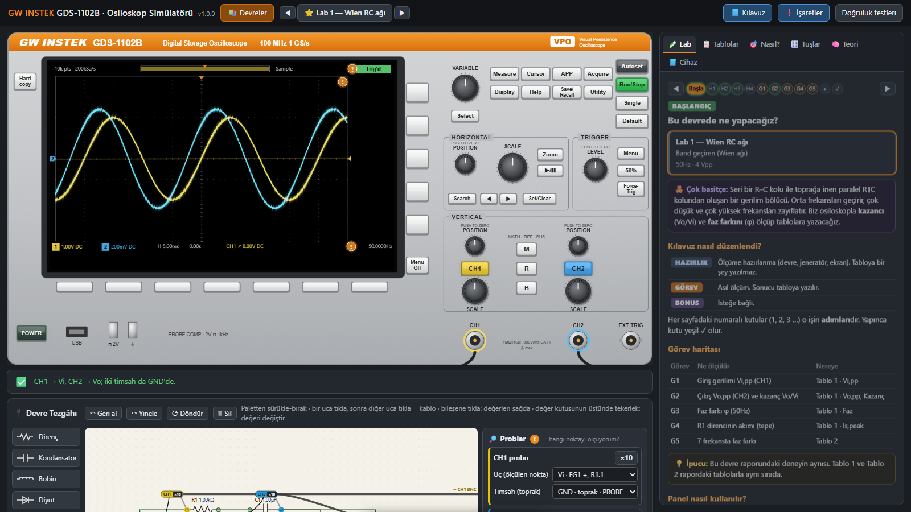

# 🔬 GDS-1102B Osiloskop Simülatörü

**GW Instek GDS-1102B** dijital osiloskobunun tarayıcıda çalışan simülatörü. Devre tezgâhı ve adım adım laboratuvar kılavuzu da içinde.
Gerçek laboratuvara gitmeden önce osiloskop kullanmayı öğrenmek, faz/kazanç ölçümlerini denemek ve kendini test etmek için yapıldı.

### ▶️ Hemen kullan: **https://memreyildirim884.github.io/osiloskop-simulatoru/**

Kurulum yok, hesap yok. Linki aç ve kullan. Bilgisayarda, tablette ve telefonda çalışır (en rahatı bilgisayar).



---

## ✨ Neler var?

| | |
|---|---|
| 🎛️ **Gerçekçi ön panel** | Tüm tuşlar ve düğmeler, alt/yan menüler, Autoset, Measure (36 ölçüm), Cursor, Math (CH1 − CH2, FFT), XY, Average, Run/Stop, Single… Değerler cihazın teknik özelliklerine göre: 8 bit ADC, 1 GSa/s, 1 mV–10 V/div, 5 ns–100 s/div. |
| 🔌 **Devre tezgâhı** | Direnç, kondansatör, bobin, diyot, jeneratör ve op-amp sürükle-bırak eklenir. Devre gerçek zamanlı çözülür (MNA, transient). Problar ×1/×10, timsah klipsi yanlış yere takılırsa kısa devre uyarısı verir. |
| 📚 **31 hazır devre** | ⭐ EE212 Lab 1 (Wien RC ağı) · ⭐ Lab 2 (op-amp türev alıcı, LM741 ±15 V) · 🎓 13 öğretmeli devre (RC, CR, RL, LR, seri/paralel RLC, iki kademeli RC/CR, lag, lead, Twin-T, yüklü RC) · 📝 16 test devresi (kılavuz gizli). |
| 🧪 **Adım adım kılavuz** | Her devre için hazırlık + 5 görev: Vi, Vo/kazanç, faz (imleçle), akım, frekans taraması. Her adımda "👁 Göster" ilgili tuşu yanıp sönen halkayla işaretler, "⚡ Benim için yap" o işi senin yerine yapar, canlı ölçüm değerlerini gösterir ve teoriyle karşılaştırır. |
| 📝 **Kendini test et** | Test devrelerinde kılavuz ve teorik değerler gizli. Ölç, tabloya yaz, **Kontrol et** → skorunu gör. |
| ❗ **Ekran açıklamaları** | Ekrandaki turuncu **!** işaretlerine bas. İmleç kutusu, ölçüm satırı, alt/üst bilgi çubukları ve menüler o anki değerlerle satır satır açıklanır. |
| 💡 **Akıllı ipucu çubuğu** | "Dalga ekrandan taşıyor", "tetiklenmiyor → 50%", "prob ×1 ama menüde 10X" gibi hataları anında söyler ve tek tıkla düzeltir. |
| 📋 **Rapor tabloları** | Ölçümleri "Ekrandan al" ile kaydeder, teoriyle % farkını hesaplar, Word'e kopyalar ya da CSV indirir. |

---

## 📲 Uygulama olarak yükle (isteğe bağlı)

Uygulama olarak yüklersen masaüstünde/ana ekranda ikonu olur, kendi penceresinde açılır ve **internetsiz de çalışır**.

- **Bilgisayar (Chrome / Edge):** siteyi aç → sağ üstteki **⬇ Uygulamayı yükle** düğmesi ya da adres çubuğundaki ⊕ (yükle) simgesi.
- **Android (Chrome):** menü ⋮ → **Ana ekrana ekle / Uygulamayı yükle**.
- **iPhone / iPad (Safari):** Paylaş □↑ → **Ana Ekrana Ekle**.

## 🔄 Güncellemeler nasıl gelir?

**Hiçbir şey indirmen gerekmez.** Yeni sürüm yayınlanınca:
- Siteyi her açışında otomatik olarak en yeni sürüm gelir.
- Uygulama zaten açıksa altta **"🆕 Yeni sürüm hazır → Şimdi güncelle"** çıkar. Tek tıkla güncellenir; sadece değişen dosya iner.
- Kendi ölçümlerin ve ilerlemen (tablolar, test skorları) tarayıcında saklanır, güncellemede silinmez.

Sürüm numarası başlığın yanında yazar (ör. `v1.0.0`). Yenilikler için: [CHANGELOG.md](CHANGELOG.md).

---

## 🧭 Kısa kullanım

1. Üstten **📚 Devreler** → bir devre seç (ilk sefer için ⭐ Lab 1).
2. Sağdaki **🧪 Lab** sekmesini takip et: önce HAZIRLIK, sonra GÖREV 1–5.
3. **Düğme çevirmek:** fareyi düğmenin üstüne getir, tekerleği çevir (yukarı = saat yönü). **Tuşa basmak:** tıkla.
4. Bir şeyi anlamadın mı? Ekrandaki **!** işaretlerine bas ya da tuşun üstünde bekle.
5. Ekran karıştıysa: **Autoset**. Hâlâ karışıksa **Default**, sonra Autoset.

> ⚠️ Bu bir eğitim simülatörüdür; gerçek cihazın yerine geçmez. Bazı ayrıntılar (menü düzeni, gürültü, iç dirençler) yaklaşıktır. **GW Instek ile hiçbir bağlantısı yoktur**; "GW Instek" ve "GDS-1102B" ilgili sahiplerinin markalarıdır ve burada yalnızca hangi cihazın taklit edildiğini belirtmek için kullanılır.

---

## 👩‍💻 Geliştiriciler için

Harici kütüphane yok. Derleme için sadece [Node.js](https://nodejs.org) gerekir.

```
src/                 kaynak modüller (sırayla birleştirilir)
  00_head.html       sayfa iskeleti + CSS
  01_units_mna.js    birimler + devre çözücü (Modified Nodal Analysis)
  02_bench_model.js  tezgâh veri modeli, netlist
  02_circuits.js     devre kütüphanesi + AC (fazör) analiz (teorik değerler)
  03…09              osiloskop: durum, simülasyon, edinim, ölçüm, math, ekran, menüler
  10_panel.js        ön panel (SVG)
  11_benchui.js      tezgâh arayüzü
  12_tests.js        doğruluk testleri
  13_app.js          ana döngü, kayıt, PWA/güncelleme
  15_guide.js        kılavuz, test modu, tablolar, ipuçları
  16_info.js         ekrandaki "!" açıklamaları
build.js             src/ → index.html (tek dosya) + sürüm etiketini sw.js'e yazar
sw.js                service worker (çevrimdışı çalışma + güncelleme)
manifest.webmanifest, icons/   uygulama (PWA) bilgileri
```

Yerelde çalıştırmak için: `node build.js`, sonra `index.html`'i tarayıcıda aç (çift tıklama yeterli). Uygulama/çevrimdışı özelliklerini denemek için bir yerel sunucu gerekir: `python -m http.server`, sonra http://localhost:8000.

### Yeni sürüm yayınlama

```bash
# 1) src/ içindeki dosyaları düzenle
# 2) sürümü artır ve derle (1.0.0 → 1.0.1)
npm run release:patch          # büyük yenilik için: npm run release:minor
# 3) CHANGELOG.md'ye ne değiştiğini yaz
# 4) yükle
git add -A && git commit -m "v1.0.1: ..." && git push
```

GitHub Pages birkaç dakika içinde siteyi günceller. Kullanıcılara "Yeni sürüm hazır" bildirimi kendiliğinden gider. **Sürümü artırmayı unutma**: service worker önbelleği sürüm numarasına bağlı.

Değişiklikten sonra uygulamadaki **Doğruluk testleri** düğmesiyle simülatörün hâlâ doğru ölçtüğünü kontrol edebilirsin.

## 📄 Lisans

[MIT](LICENSE): serbestçe kullan, değiştir, paylaş.
